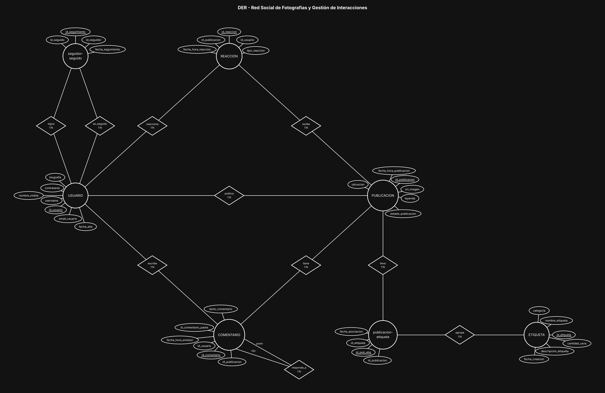

# BaseDeDatos-U2-Ej12-RedSocialFotografias

Base de Datos - Unidad 2 - Ejercicio 12

## Consigna

Modelar la estructura conceptual de una red social de fotografía: perfiles de usuario con seguimiento entre ellos, publicaciones con hashtags, comentarios encadenados en árbol y reacciones únicas por usuario y publicación.

## Lógica

**Seguidores: autorrelación N:M sobre USUARIO.** Un usuario sigue a muchos y es seguido por muchos, así que la autorrelación se resuelve con la entidad intermedia `seguidor-seguido`, conectada dos veces a USUARIO con los dos roles (`sigue` y `es_seguido`). Los dos roles son los que hacen que el seguimiento sea **unidireccional**: que A siga a B es una fila, y que B siga a A es otra distinta. La relación bidireccional (amistad mutua) no es una estructura aparte, es simplemente que existan las dos filas. `fecha_seguimiento` es atributo del vínculo.

**Comentarios: autorrelación 1:N, no N:M.** Acá está la diferencia clave con el caso anterior y es lo que conviene tener claro: un comentario puede tener muchas respuestas, pero cada respuesta cuelga de **un solo** comentario padre. Al ser 1:N recursiva no hace falta entidad intermedia: alcanza con la FK `id_comentario_padre` apuntando a la misma entidad y un rombo que vuelve sobre COMENTARIO con los roles padre / hijo. Los comentarios raíz tienen ese campo en NULL, y el anidamiento en árbol sale de recorrer la jerarquía.

**Publicación ↔ Etiqueta: N:M con `publicacion-etiqueta`.** Una publicación lleva muchos hashtags y un hashtag agrupa muchas publicaciones. ETIQUETA es entidad propia (no un texto repetido dentro de la publicación) porque el enunciado pide que el nombre sea único y porque así se pueden buscar todas las publicaciones de `#sunset` sin recorrer texto libre.

**Reacciones: N:M entre USUARIO y PUBLICACION resuelto con REACCION.** El `tipo_reaccion` (Me gusta / Me encanta / Asombroso) es atributo del vínculo: depende de quién reacciona y a qué. La regla de que un usuario no pueda duplicar su reacción se garantiza con una **clave candidata UNIQUE sobre (`id_usuario`, `id_publicacion`)**: la PK artificial `id_reaccion` identifica la fila, pero el par usuario-publicación no puede repetirse. Si el usuario cambia de "Me gusta" a "Me encanta", se actualiza la fila existente en lugar de insertar una nueva.

**Los comentarios cuelgan de la publicación y del usuario por separado.** COMENTARIO tiene dos relaciones 1:N entrantes (quién lo escribió y dónde), que no son redundantes entre sí: el autor del comentario no tiene por qué ser el de la publicación.

**Restricciones de integridad a considerar:** en `seguidor-seguido`, UNIQUE sobre el par (`id_seguidor`, `id_seguido`) y un CHECK que impida que un usuario se siga a sí mismo; en COMENTARIO, que `id_comentario_padre` apunte a un comentario de la **misma** publicación y control de ciclos en el árbol; borrado en cascada de comentarios y reacciones al eliminar una publicación.

**Convención de claves.** Toda entidad lleva como PK un identificador propio `id_<entidad>` (subrayado en el diagrama) y al menos 5 atributos además del id; el código o documento de negocio (`dni`, `codigo_*`, `legajo`, etc.) queda como atributo común con restricción UNIQUE. Las entidades intermedias de las relaciones N:M llevan los tres ids: el propio y las dos FK de las entidades que unen (UNIQUE compuesto sobre ambas FK). Atributos agregados para llegar al mínimo de 5 y que no figuran en la consigna: `ubicacion` en PUBLICACION.

## Resultado

